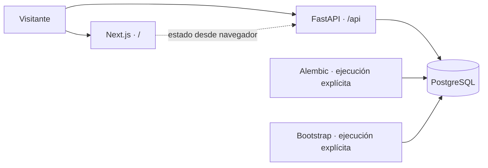

# Arquitectura general

Un monorepo contiene dos procesos desplegables y una base PostgreSQL: Next.js presenta la interfaz pública, FastAPI expone contratos HTTP versionados y PostgreSQL conserva identidad, inscripciones y resultados. No hay microservicios internos, caché distribuida ni colas en esta etapa.

La web no consulta la base. `NEXT_PUBLIC_API_URL` configura la API accesible por el navegador; es público y se fija durante la compilación de producción. En App Platform se usa `/api/v1`, conservando `/api` en ingress. La web puede compilar sin API ni base.

FastAPI usa una factory y lifespan: valida configuración antes de atender, crea un engine por proceso y lo libera al detenerse. SQLAlchemy 2 utiliza sesiones síncronas cortas; endpoints síncronos corren en el threadpool de FastAPI. El pool se limita a 3 conexiones persistentes y 2 adicionales por proceso; no se escala el número de workers sin recalcular el presupuesto de conexiones.

Alembic mantiene una revisión congelada y un bloqueo asesor transaccional para serializar migraciones. El servidor nunca hace `create_all` ni migra en startup. El bootstrap usa upserts PostgreSQL dentro de una transacción explícita. Los triggers diferidos validan el estado final al commit, permitiendo construir un equipo o resultado en varios INSERT dentro de la misma transacción.

La integración start.gg usa HTTPX asíncrono y snapshots Pydantic desde una CLI administrativa; el servidor público no llama al proveedor. Rankings permanece como contrato sin cálculo. Se mantienen identificadores externos como texto, separados de UUID internos. Los futuros juegos individuales de un set y sus selecciones de personajes se relacionarán con `sets`, `set_sides` y `characters`, sin agregarlos todavía.

El entorno local usa Docker Compose. Producción está preparada para App Platform y PostgreSQL Managed existente, con TLS y roles separados. No se despliega nada como parte de esta misión.

## Importación Misión 02

La CLI mantiene una conexión PostgreSQL y bloqueos de sesión mientras descarga, valida y publica. Confirma el job inicial por separado; dominio y job completed se confirman juntos. Un rollback conserva la versión pública anterior. Next.js obtiene torneos, eventos, miembros, sets y jugadores exclusivamente de FastAPI con paginación. No se introduce autenticación, API administrativa, cola ni worker.

La revisión 0002 agrega publicación, metadata, locks manuales, conflictos, conteos y evidencia JSON de resultados. No reemplaza tablas ni modifica 0001. Ver ADR-006, ADR-007 y ADR-008 y el runbook de importación.

## Misión 02.1

La clasificación de sets distingue lifecycle_status, resolution y elegibilidad; conserva status legado para compatibilidad con triggers congelados. El cliente recupera explícitamente state=5, y la API/web separan entradas de bracket de encuentros. ADR-009 documenta la decisión y la migración incremental 0003. No se agrega servicio, worker ni cálculo estadístico.
