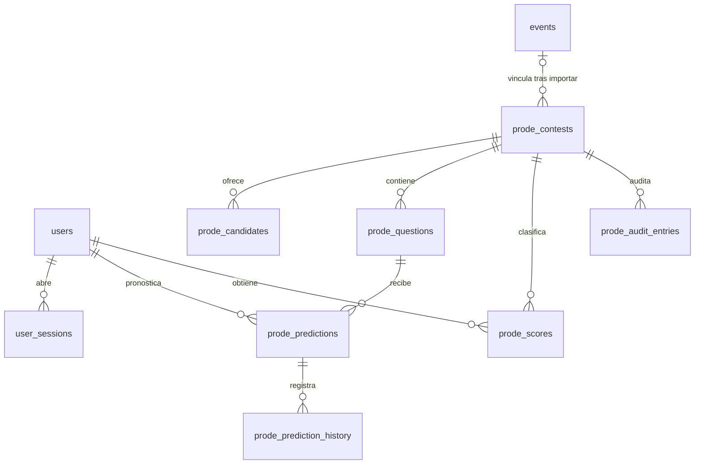

# Prode — análisis de viabilidad e integración (Misión SH-PRODE-01)

Fecha: 10 de noviembre de 2026 (America/Asuncion). Estado: análisis aprobado; **fases 0 y 1 implementadas** (ver [ADR-020](../adr/ADR-020.md)).

Decisiones tomadas tras el análisis:

- **Login:** OAuth de start.gg.
- **Premio:** logros por pronosticar, que se ven en el perfil del pronosticador y en la ficha del jugador vinculado.
- **Alcance:** fase 0 y fase 1.

Diferencias con la propuesta original:

- La liquidación oficial lee directamente las posiciones finales de start.gg (`standings` con `isFinal`) en vez de esperar a la importación. Es la misma fuente y queda disponible apenas termina el evento. Se puede repetir después de una corrección.
- El Top 8 vale 2 puntos por acierto.

Cada hallazgo indica de dónde sale. **Confirmado** significa verificado en el código o en una consulta real a start.gg hecha durante esta misión. **Riesgo** significa algo posible que todavía no se comprobó.

---

## Resumen ejecutivo

1. **¿Es viable con la arquitectura actual?** Sí, como módulo nuevo dentro de la API y la web actuales, sin servicios nuevos. Hay **un bloqueante**: Smash Hub no tiene cuentas de usuario. La única autenticación es la clave compartida de organizadores (`app/core/admin.py`, ADR-011). Sin una forma de identificar a cada pronosticador no hay Prode, así que la autenticación es la fase 0 obligatoria.
2. **¿Qué se reutiliza?** Los inscriptos reales y el seeding publicado de la previa (`/insights/upcoming/{slug}`), el bracket proyectado con winners, losers y todas las fases (`app/brackets/service.py`), la lectura en vivo con estados de set y la lógica de gran final y reset (`app/live/service.py`), las posiciones finales que guarda la importación (`event_entrants.placement`), las identidades de start.gg de cada jugador, el patrón de auditoría solo-inserción del seeding y los componentes visuales (bracket, banderas, mains, tags).
3. **Principales limitaciones.** No hay cuentas. Los resultados oficiales llegan solo cuando un organizador importa el torneo, después de jugado. Durante el torneo los datos vienen de start.gg con hasta ~60 s de demora y nunca se guardan. No existe una hora programada de cada set. Los IDs de set de start.gg cambian cuando arranca el bracket. No hay worker ni cron: todo corre en una única instancia de 0,5 GB.
4. **MVP más sencillo y útil.** Un Prode previo al torneo para el evento principal de singles: campeón, subcampeón y Top 8. Se cierra al empezar el evento, se liquida con las posiciones oficiales de la importación y tiene un ranking del torneo. Vive como una pestaña de la previa. Necesita antes el login.
5. **Decisiones previas.** El proveedor de login (start.gg OAuth, Discord u otro), si habrá premios, si los jugadores inscriptos pueden pronosticar, la política de cierre, los puntos definitivos, qué se muestra de los pronósticos ajenos antes del cierre y el tratamiento de datos personales. Ver §9.

---

## 1. Arquitectura actual (lo necesario para el Prode)

| Área | Estado verificado | Fuente |
|---|---|---|
| Monorepo | `apps/web` (Next.js 16.4, React 19.3) y `apps/api` (FastAPI 0.128, SQLAlchemy 2, Alembic, psycopg 3, HTTPX). Sin otras dependencias de runtime. | `apps/web/package.json`, `apps/api/requirements.in`, ADR-001 |
| Web | App Router. Las páginas son componentes cliente que piden datos a la API (`Resource` en `competition-browser.tsx`). La web nunca consulta la base. | `docs/architecture/overview.md` |
| API | Endpoints síncronos en el threadpool, sesiones cortas y pool de 3 + 2 conexiones. Cachés en memoria del proceso (`app/core/stale.py`, `insights/engine.py`) e hilos en segundo plano (`integrations/startgg/bulk.py`). **No hay cola, worker ni tareas programadas.** | `overview.md`, `infra/digitalocean/app.yaml` |
| Base de datos | PostgreSQL gestionado. 17 migraciones (`0001`…`0017`) que se aplican de forma explícita, nunca al arrancar. UUID internos e IDs externos como texto (ADR-004). | `apps/api/migrations/versions`, `docs/database/schema.md` |
| Infraestructura | DigitalOcean App Platform: web y API con **1 instancia `apps-s-1vcpu-0.5gb` cada una**, `deploy_on_push: false`. | `infra/digitalocean/app.yaml`, ADR-003 |
| Autenticación | **Solo `ADMIN_TOKEN` compartido**: Bearer, comparación en tiempo constante, 10 fallos por IP cada 10 min. El nombre del editor es declarado por quien edita. En el navegador se guarda en `sessionStorage`. **No hay usuarios, sesiones, roles ni cookies de login.** | `app/core/admin.py`, `apps/web/src/lib/admin.ts`, ADR-011 |
| Roles y permisos | Dos niveles: lector anónimo y organizador con clave (`Admin` / `MaybeAdmin`). | `app/core/admin.py` |
| Torneos y resultados | `tournaments → events → event_entrants / sets / set_sides`, con jugadores vinculados por `external_identities` (ID de start.gg). La importación guarda `event_entrants.placement` **solo cuando start.gg la marca como final** (`isFinal`) y publica el torneo al terminar (`tournament.published = True`). | `app/competitions/models.py`, `app/integrations/startgg/service.py:371,509` |
| Cómo entran los resultados | Importación manual: un organizador la dispara desde el panel o la CLI (ADR-008, ADR-013). Es idempotente, con locks y `import_jobs`. No hay sincronización automática. | ADR-013, `integrations/startgg/bulk.py` |
| Torneos próximos | La previa lee de start.gg el torneo, el evento de singles y los inscriptos (15 min con copia stale), y les aplica el seeding publicado por el hub. | `app/insights/router.py` (`_upcoming`), `app/insights/preview.py` |
| Bracket proyectado | Llaves reales de start.gg de todas las fases (pools, TOP 32, TOP 8) con winners y losers, suponiendo que gana el mejor seed. | `app/brackets/service.py` (`fetch_structure`, `seeded`) |
| En vivo | Torneos de PY empezados en las últimas 36 h. Se leen de start.gg cada 60 s, con una sola lectura a la vez y la copia anterior mientras tanto. **No se guarda nada.** Estados en juego: `{2, 6}` (en juego y llamado a setup). | `app/live/service.py`, `app/live/router.py` |
| Cliente start.gg | Un pedido por segundo por cliente, reintentos con `Retry-After` y paginación validada. Las lecturas pesadas tardan de 18 a 30 s (medido el 10/11 con CENTER STAGE 2026: estructura 18 s, pools 28 s). | `app/integrations/startgg/client.py` |
| Navegación | Siete módulos fijos en `apps/web/src/lib/modules.ts`, más la previa `/previa/[slug]` y el en vivo `/en-vivo/[slug]`. | `modules.ts`, `apps/web/src/app` |

---

## 2. Funcionalidades existentes reutilizables

| Necesidad del Prode | Qué existe | Cómo se usa |
|---|---|---|
| Lista de candidatos de un torneo próximo | `preview.fetch` y `seeding_startgg.fetch_entrants` (inscriptos con ID de jugador de start.gg); `/insights/upcoming/{slug}` con tag, prefijo, bandera, mains y seed. | Las opciones del pronóstico se identifican con el **ID de jugador de start.gg**, igual que la previa. Así entran también los extranjeros que no están en el hub (`id: null`). |
| Favoritos y contexto para pronosticar | Seeding publicado, `favorites`, `crossings`, H2H y récord de start.gg de extranjeros. | Se muestra al lado del formulario sin costo extra. |
| Bracket para pronosticar por sets | `brackets.service.seeded` y `BracketView` (`apps/web/src/components/bracket.tsx`). | Base visual para elegir ganadores en la fase 2. |
| Estado de cada set en vivo | `live/service.py`: `status_of` (played, dq, called, live, pending), `RUNNING = {2, 6}`, `best_of` y `decided()`, que sabe si la gran final quedó definida con o sin reset. | Cierre y liquidación provisoria de los pronósticos por set. |
| Posiciones finales oficiales | `event_entrants.placement`, con `isFinal` de start.gg, después de la importación. | Liquidación oficial del modo A. |
| Jugadores sin duplicar | `players` y `external_identities` (fuente start.gg). | El Prode guarda el ID de start.gg y cruza con el hub para mostrar ficha, mains y bandera. No crea jugadores. |
| Auditoría | `seeding_audit_entries`: solo inserción, con acción, actor y detalle. | Mismo patrón para `prode_audit_entries`. |
| Escrituras de organizador | `Admin` (clave compartida). | Abrir, cerrar, anular y liquidar un Prode. No sirve para los usuarios. |
| Cachés tolerantes a start.gg lento | `app/core/stale.py`. | Lecturas de candidatos y estados sin bloquear a los usuarios. |
| Imágenes para redes | Rutas `apps/web/src/app/og/*` (podio, ranking, seeding). | Fase 3: imagen del ranking del Prode. |

---

## 3. Limitaciones técnicas

### Confirmadas en el código o en start.gg

1. **No hay cuentas de usuario** (`app/core/admin.py`; ninguna tabla de usuarios en `schema.md`; ninguna dependencia de auth en `requirements.in` ni en `package.json`). Es el primer dato personal que guardaría el sistema.
2. **Los resultados oficiales llegan tarde y a mano.** La base se actualiza solo con una importación disparada por un organizador (ADR-013). Durante el torneo la única fuente es la lectura en vivo, que no se guarda (`live/service.py`, docstring).
3. **Demora de hasta ~60 s, más lo que tarde start.gg**, en ver que un set empezó (`LIVE_SECONDS = 60`; una lectura completa de un evento de 88 inscriptos lleva varios segundos con el ritmo de 1 pedido/s).
4. **No hay hora programada de cada set.** start.gg da `state` (llamado, en juego, terminado) y `startedAt` o `completedAt` cuando ocurren (`graphql/sets.graphql`), no una agenda. El cierre por set solo puede basarse en el estado observado.
5. **Los IDs de set del bracket vacío son provisorios.** Antes de que arranque la fase, start.gg devuelve IDs como `preview_3408751_1_1` (observado el 10/11). Al arrancar los reemplaza por IDs reales. Un pronóstico por set no puede anclarse a ese ID: debe usar una clave estable (grupo, ronda y posición, o los dos jugadores).
6. **El formato al mejor de 3 o de 5 no es confiable en start.gg.** `totalGames` dice 5 aunque se juegue al mejor de 3. El hub lo deduce del nombre de la fase ("Pools (BO3)") o de un marcador decisivo (`live/service.py`, `best_of`). El "resultado exacto" depende de esta deducción.
7. **Casos especiales del doble eliminación ya modelados:** el DQ trae un marcador de `-1` (`status_of`); los byes y el reset no usado no se muestran (`shown`); el reset existe solo si pierde quien viene de winners (`decided`).
8. **Una sola instancia, sin worker.** Las cachés y los hilos viven en memoria y se pierden al reiniciar (ADR-011, ADR-013). Si la liquidación depende de un hilo, tiene que poder repetirse sin efectos dobles.
9. **El presupuesto de conexiones es chico** (pool de 3 + 2). Calcular el ranking en cada visita no escala si crecen los usuarios: hace falta una tabla de puntajes derivada.
10. **Inscripciones y seeds cambian hasta el día del torneo.** Hay bajas, altas y movimientos de pools (ADR-019 sube cambios de seeding a start.gg desde la web).

### Riesgos potenciales (sin verificar)

- **OAuth de start.gg o Discord.** No se probó en esta misión ningún flujo OAuth. Hay que verificar disponibilidad, permisos (scopes) y condiciones antes de elegir.
- **Calidad de `startedAt`.** Si los organizadores no marcan el set como empezado en start.gg, el estado pasa directo a terminado y el cierre por estado no actúa a tiempo.
- **Manipulación de resultados.** Quien organiza el torneo en start.gg puede corregir resultados. Si también participa del Prode hay conflicto de interés. Las correcciones obligan a recalcular.
- **Abuso de cuentas** (multicuentas para "cubrir" opciones). Depende del proveedor de login.
- **Marco legal.** Un Prode con dinero o premios puede considerarse apuesta. Se recomienda que sea gratuito y sin premios económicos hasta tener asesoramiento.
- **Carga en el día del torneo.** Un pico de usuarios en el en vivo no golpea a start.gg (lectura compartida), pero sí a la API de 0,5 GB y al pool de la base.

---

## 4. Diseño funcional propuesto

### Conceptos

- **Prode (concurso):** uno por evento de start.gg (en general, Ultimate Singles), creado y abierto por un organizador.
- **Pregunta:** cada cosa a pronosticar (campeón, Top 8, ganador del set X…), con su propio cierre y su propio estado.
- **Pronóstico:** la respuesta de un usuario a una pregunta. Hay uno por usuario y pregunta, y es editable hasta el cierre.
- **Liquidación:** cálculo de puntos a partir de un resultado. Puede ser provisoria (en vivo) u oficial (importación o confirmación del organizador).

### Modo A: previo al torneo

| Pregunta | Respuesta | Resultado oficial |
|---|---|---|
| Campeón | 1 jugador inscripto | `placement = 1` |
| Subcampeón | 1 jugador, distinto del campeón | `placement = 2` |
| Top 8 | 8 jugadores distintos | `placement ≤ 7` (en doble eliminación el 5.º y el 7.º son puestos compartidos) |
| Posición de jugadores destacados (opcional) | Un tramo de start.gg: 1, 2, 3, 4, 5, 7, 9, 13, 17, 25, 33… | `placement` del jugador |
| Bracket completo (no recomendado para el MVP) | Ganador de cada set | Demasiadas preguntas y depende de IDs provisorios (§3.5) |

- **Candidatos:** los inscriptos de start.gg al abrir el Prode, guardados como foto con ID de jugador, tag y seed. Se refrescan mientras el Prode esté abierto.
- **Cambios de inscripción:** si un jugador elegido se da de baja **antes del cierre**, el pronóstico queda marcado y se le avisa al usuario para que lo cambie. Si se da de baja **después del cierre**, la elección no suma: no se devuelve ni se reemplaza.
- **Cierre:** lo que ocurra primero entre la hora de inicio del evento en start.gg, el primer set observado en juego o llamado, y el cierre manual del organizador. La API rechaza cualquier escritura posterior usando la hora del servidor de base de datos.
- **Liquidación:** provisoria cuando `decided()` da verdadero en el en vivo, oficial al importar el torneo (`placement` con `isFinal`).

### Modo B: por enfrentamientos

- Solo se ofrecen sets con **los dos jugadores definidos** (en start.gg, dos inscriptos en el set y estado pendiente). Los sets todavía vacíos no se pueden pronosticar.
- **Clave del set:** grupo de fase, ronda y los IDs de jugador de start.gg de ambos lados. Si cambian los jugadores (corrección o DQ), la pregunta se **anula** y no suma ni resta.
- **Cierre por set:** al observar el estado llamado o en juego, o `startedAt`. Como hay demora (§3.3), se agrega una segunda barrera: al liquidar, se anula todo pronóstico guardado después del `startedAt` que informe start.gg. Si start.gg nunca informa `startedAt`, rige solo el cierre observado.
- **Recomendado: cerrar por ronda.** Todos los sets de una ronda cierran cuando empieza el primero. Es más simple de entender, reduce el aprovechamiento de la demora y no necesita hora exacta.
- **Finales destacadas:** Winners Final, Losers Final y Grand Final como preguntas propias con más puntos.
  - **Grand Final:** se pronostica **quién gana la gran final**, contando el reset si se juega. Se liquida con `decided()`.
  - **Resultado exacto de la gran final:** aplica solo al primer set. El reset no tiene preguntas propias en el MVP del modo B.
- **DQ, bye o set no jugado:** la pregunta se anula.

---

## 5. Alternativas de arquitectura

### Dónde vive el Prode

| Opción | A favor | En contra |
|---|---|---|
| **A. Módulo `app/prode` en la API actual (recomendada)** | Reutiliza la sesión de base, la previa, el en vivo y los componentes. Sin infraestructura nueva. Sigue ADR-001. | Comparte la instancia de 0,5 GB y el pool de conexiones. |
| B. Servicio separado | Aísla la carga. | Duplica jugadores y torneos, suma costo y contradice "integrado en Smash Hub". |

### Cómo se identifica a los usuarios (fase 0)

| Opción | A favor | En contra |
|---|---|---|
| **OAuth de start.gg** | Los jugadores ya tienen cuenta. Permite vincular la cuenta a un jugador y detectar conflictos de interés. Implementable con HTTPX y la librería estándar (sin dependencias nuevas). | **Sin verificar**: disponibilidad, permisos y condiciones. No todos los espectadores tienen cuenta. |
| OAuth de Discord | Muy usado por comunidades de juegos. Mismo esfuerzo técnico. | No vincula con jugadores de forma automática. **Sin verificar** que la comunidad lo use. |
| Enlace mágico por e-mail | Universal. | Necesita un proveedor de e-mail (servicio y dependencia nuevos, costo) y guarda e-mails. |
| Apodo y código | Trivial. | Sin control de multicuentas. Solo sirve para una prueba cerrada. |

**Recomendación:** OAuth (start.gg si se confirma, si no Discord), con sesión en cookie `HttpOnly`, `Secure` y `SameSite=Lax`, firmada con HMAC de la librería estándar y con tabla de sesiones para poder revocarlas. Las escrituras con cookie necesitan protección CSRF (origen verificado o token doble). No se reutiliza `ADMIN_TOKEN`.

### Cómo y cuándo se liquida

| Opción | Descripción |
|---|---|
| **Botón del organizador más recálculo idempotente (recomendada para el MVP)** | Al importar el torneo, o con un botón "Liquidar", se recalculan desde cero todos los puntos del Prode en una transacción. |
| Liquidación provisoria en el en vivo (fase 2) | Cada lectura de `live.reading` (60 s, una a la vez) actualiza los resultados provisorios. No suma pedidos a start.gg. |
| Worker o cron | No existe en la infraestructura actual. Se agrega solo si lo anterior no alcanza (costo y mantenimiento). |

---

## 6. Modelo de datos propuesto

Todas las tablas son nuevas, con migraciones aditivas y sin tocar las existentes. Usan las convenciones del esquema: UUID, `created_at` y `updated_at`.

| Tabla | Campos principales | Notas |
|---|---|---|
| `users` | `provider`, `provider_user_id` (único por proveedor), `display_name`, `startgg_player_id` (nulo), `banned_at` | Primer dato personal del sistema: guardar lo mínimo. |
| `user_sessions` | `user_id`, `token_hash`, `expires_at`, `revoked_at` | La cookie lleva un token; la base guarda solo su hash. |
| `prode_contests` | `startgg_event_slug`, `event_id` (FK nula, se completa al importar), `name`, `status` (borrador, abierto, cerrado, liquidado, anulado), `locks_at`, `rules` (JSON), `rules_version`, `published` | Las reglas viajan con el concurso: cambiar valores no altera concursos pasados. |
| `prode_candidates` | `contest_id`, `startgg_player_id`, `startgg_entrant_id`, `tag`, `seed`, `withdrawn_at` | Foto de los inscriptos. No crea jugadores. |
| `prode_questions` | `contest_id`, `kind` (champion, runner_up, top8, placement, set_winner, set_score, winners_final, losers_final, grand_final), `subject` (JSON: jugador o clave estable del set), `locks_at`, `locked_at`, `status` (abierta, cerrada, liquidada, anulada), `result` (JSON), `result_source` (live, import, manual), `settled_at` | Una pregunta por cosa a pronosticar, con su cierre propio. |
| `prode_predictions` | `question_id`, `user_id`, `value` (JSON), único por pregunta y usuario | Editable solo con la pregunta abierta. Se valida en el servidor. |
| `prode_prediction_history` | `prediction_id`, `value`, `saved_at` | Solo inserción: historial de cambios. |
| `prode_scores` | `contest_id`, `user_id`, `points`, `exact_hits`, `hits`, `settled`, `rank`, `last_saved_at`, `computed_at` | Tabla derivada: se borra y se vuelve a calcular en cada liquidación. |
| `prode_audit_entries` | `contest_id`, `action`, `actor`, `details` | Solo inserción, como `seeding_audit_entries`. |

El ranking acumulado (fase 3) se obtiene sumando `prode_scores` por temporada. No necesita más tablas hasta que el volumen lo pida.

---

## 7. Puntuación y reglas de cierre

### Valores sugeridos (configurables por concurso)

| Pronóstico | Puntos | Comentario |
|---|---:|---|
| Campeón correcto | 10 | |
| Subcampeón correcto | 7 | |
| Cada integrante del Top 8 acertado | 2 | Con 3 puntos, el Top 8 (24) pesaría más que campeón y subcampeón juntos. Con 2 queda en 16. |
| Posición exacta de un jugador destacado | 5 | Por tramo de start.gg (5.º y 7.º compartidos). |
| Ganador de un set | 2 | |
| Resultado exacto de un set | +2 (4 en total) | **No acumulativo por error**: el exacto incluye al ganador. |
| Winners Final, Losers Final y Grand Final | 4 | Preguntas propias. Grand Final cuenta el reset. |

### Reglas

- **El cálculo es del backend.** Una función pura `score(rules, questions, predictions)` en `app/prode/engine.py`, como `app/seeding/engine.py`, con tests. El frontend nunca envía puntos.
- **Sin duplicaciones.** Cada liquidación borra y recalcula `prode_scores` del concurso dentro de una transacción con bloqueo del concurso (`SELECT … FOR UPDATE`). Repetirla da el mismo resultado.
- **Correcciones.** Si cambia un resultado (reimportación o corrección de start.gg), se vuelve a liquidar todo el concurso y queda una entrada en la auditoría.
- **Anulaciones.** Una pregunta anulada (DQ, bye, set no jugado, jugadores cambiados) no suma y no cuenta en el porcentaje de precisión.
- **Pronósticos cerrados.** La API rechaza la escritura si la pregunta está cerrada o `now() ≥ locks_at`, con la hora de la base. Además, en el modo B se anula al liquidar lo guardado después de `startedAt`.
- **Historial.** Cada guardado inserta una fila en `prode_prediction_history`. Nada se borra.
- **Privacidad antes del cierre.** Los pronósticos ajenos se muestran recién al cerrar, para que no se copien. Antes solo se muestran cifras agregadas, si se decide así.
- **Desempates del ranking del torneo:** 1) más puntos, 2) más aciertos exactos (campeón, posición, resultado), 3) más aciertos totales, 4) último guardado más temprano. Si todo empata, la posición es compartida.

---

## 8. Plan por fases

### Fase 0: cuentas de usuario (requisito)

- **Funcionalidades:** ingresar y salir con el proveedor elegido, perfil mínimo (nombre visible) y, opcionalmente, vínculo con un jugador de start.gg.
- **Backend:** `app/auth` con el flujo OAuth vía HTTPX, sesiones en cookie firmada, CSRF y límite de intentos.
- **Frontend:** botón "Ingresar" en el encabezado y estado de sesión.
- **Base de datos:** `users`, `user_sessions`.
- **Dependencias:** decisión de proveedor, credenciales OAuth como secreto en App Platform y política de privacidad.
- **Complejidad:** media.
- **Riesgos:** proveedor sin verificar, primer dato personal guardado, configuración de cookies detrás del proxy de DigitalOcean (ya hay antecedentes con encabezados reenviados en `apps/web/src/lib/origin.ts`).
- **Criterios de aceptación:** un usuario entra, sale y su sesión expira y se puede revocar. Las escrituras sin sesión o sin CSRF válido se rechazan. La clave de organizadores sigue funcionando igual.

### Fase 1: MVP, Prode previo al torneo

- **Funcionalidades:** el organizador crea, abre y cierra el Prode de un evento. Los usuarios eligen campeón, subcampeón y Top 8. Hay cierre automático y manual, liquidación con botón del organizador después de la importación, ranking del torneo y "mis pronósticos".
- **Backend:** `app/prode` (router, service, engine puro, models), candidatos tomados de `preview.fetch` y liquidación con `event_entrants.placement`.
- **Frontend:** pestaña "Prode" en `/previa/[slug]` (formulario con buscador y los mismos componentes de tag, bandera y mains), página `/prode` con los concursos y su ranking, y acciones de organizador en el panel actual.
- **Base de datos:** `prode_contests`, `prode_candidates`, `prode_questions`, `prode_predictions`, `prode_prediction_history`, `prode_scores`, `prode_audit_entries`.
- **Dependencias:** fase 0, y la importación del torneo para el resultado oficial.
- **Complejidad:** media.
- **Riesgos:** bajas de último momento, olvidarse de cerrar (lo mitiga el cierre automático) y que la importación se demore días (lo mitiga una liquidación provisoria que se puede mostrar como tal).
- **Criterios de aceptación:** no se puede guardar después del cierre, ni siquiera llamando a la API directamente. Liquidar dos veces da los mismos puntos. Una corrección de resultado recalcula todo. El ranking aplica los desempates de §7. La pantalla funciona a 360 px de ancho.

### Fase 2: pronósticos por enfrentamiento

- **Funcionalidades:** sets con los dos jugadores definidos, cierre por ronda o por set, ganador y resultado exacto, finales destacadas y liquidación provisoria en vivo.
- **Backend:** claves estables de set (§3.5), cierre según los estados de `live/service.py`, anulación por `startedAt` y por cambio de jugadores, y un gancho de liquidación en `live.reading`.
- **Frontend:** pronóstico desde `/en-vivo/[slug]` y desde el bracket (`BracketView`), con aviso de cierre.
- **Base de datos:** sin tablas nuevas; nuevos tipos de pregunta.
- **Dependencias:** fase 1 y que los organizadores usen el "llamar o empezar set" de start.gg.
- **Complejidad:** alta.
- **Riesgos:** la demora del en vivo, organizadores que no marcan el inicio de los sets, el mejor de 3 o de 5 mal deducido y la carga del día del torneo.
- **Criterios de aceptación:** un set en juego no acepta pronósticos. Lo guardado después de `startedAt` se anula. Si cambian los jugadores, la pregunta se anula. El reset de la gran final se trata según §4.

### Fase 3: comunidad y estadísticas

- **Funcionalidades:** ranking acumulado por temporada, perfil público del pronosticador (historial, precisión, aciertos por tipo), ranking general e imagen para compartir.
- **Backend:** consultas sobre `prode_scores` y `prode_predictions`, más una ruta OG nueva.
- **Frontend:** `/prode/ranking` y `/prode/u/[id]`.
- **Base de datos:** índices; quizá una tabla de temporadas.
- **Complejidad:** media.
- **Riesgos:** moderación de nombres visibles y exposición de datos personales en perfiles públicos.
- **Criterios de aceptación:** el ranking acumulado coincide con la suma de los concursos y la precisión excluye las preguntas anuladas.

---

## 9. Decisiones pendientes

1. **Proveedor de login:** start.gg, Discord, e-mail o más de uno. Antes hay que verificar el OAuth elegido.
2. **Premios:** ¿habrá? Se recomienda que sea gratuito y sin premios económicos.
3. **Participación de jugadores inscriptos:** ¿pueden pronosticar? ¿Pueden hacerlo sobre sus propios sets? ¿Y los organizadores del torneo?
4. **Qué eventos tienen Prode:** solo el singles principal o cualquier evento que habilite un organizador.
5. **Política de cierre:** hora de inicio, primer set o manual; en el modo B, cierre por set o por ronda.
6. **Puntos definitivos** y si se pueden cambiar por concurso.
7. **Visibilidad:** qué se muestra de los pronósticos ajenos antes del cierre.
8. **Liquidación oficial:** solo con la importación, o también con la confirmación del organizador.
9. **Datos personales:** qué se guarda, por cuánto tiempo y si hace falta una política de privacidad publicada.
10. **Temporadas** del ranking acumulado.

---

## 10. Recomendación para el MVP

Fase 0 más fase 1, en ese orden y sin el modo B:

- Login con un único proveedor OAuth, una vez verificado.
- Un Prode por evento principal de singles, abierto por un organizador desde el panel.
- Tres preguntas: campeón (10), subcampeón (7) y Top 8 (2 por acierto).
- Cierre automático al inicio del evento, más cierre manual.
- Liquidación oficial con el botón del organizador después de la importación, recalculando todo de forma idempotente.
- Ranking del torneo con desempates, en una pestaña de la previa y en `/prode`.
- Auditoría solo-inserción de toda acción de organizador.

Es la versión que más aprovecha lo existente: inscriptos y seeding de la previa, posiciones de la importación, patrón de auditoría y componentes visuales. Además no depende de la demora del en vivo ni de los IDs provisorios de start.gg, que son los dos puntos más frágiles del modo por enfrentamientos.

## Cambio del cierre (SH-FIX-01)

El cierre (`locks_at`) se fija al abrir el Prode con el inicio confirmado del torneo, si un administrador lo cargó en la sincronización, o si no con el `startAt` del evento de start.gg (o del torneo). La sincronización nunca lo vuelve a escribir. Un administrador puede moverlo mientras el Prode está abierto y su cierre no pasó: `POST /api/v1/prode/contests/{id}/locks-at` con día y hora de Asunción (`{"locks_at": "AAAA-MM-DDTHH:MM"}`), o «Cambiar cierre» en la pestaña. Es idempotente, queda auditado (`set_locks_at`) y no toca pronósticos ni participantes. Ver [sh-fix-01.md](../operations/sh-fix-01.md).
