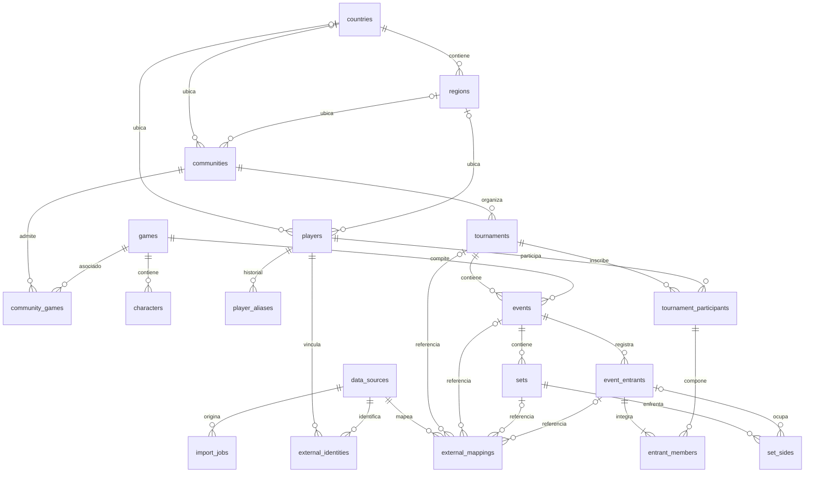

# Modelo de datos

La revisión `0001` crea 19 tablas de dominio. Todas tienen `id UUID` generado por la aplicación, `created_at TIMESTAMPTZ DEFAULT now()` y `updated_at TIMESTAMPTZ DEFAULT now()` (actualizado por SQLAlchemy en cambios ORM). Los IDs externos nunca reemplazan las claves internas. Las FKs restringen borrados de entidades referenciadas para preservar historial.

## Relaciones

La cardinalidad del roster se comprueba al commit: `team_size=1` singles, `2` dobles, otros tamaños positivos admitidos. Un torneo contiene eventos de varios juegos; el juego no es atributo del torneo. La geografía es opcional para jugadores y comunidades; cuando hay región, debe corresponder al país indicado.

## Invariantes competitivas

- `players.tag` está indexado y no es único. `player_aliases` conserva intervalos de tags; `tag_snapshot` en la inscripción evita reescribir la presentación histórica. El futuro servicio de identidad deberá cerrar y abrir aliases en una misma transacción; todavía no hay endpoint de cambio de tag.
- `tournament_participants` tiene una inscripción por jugador/torneo. `entrant_members` apunta a esta inscripción, no directamente a un nombre. FKs compuestas impiden integrar participantes de otro torneo y lados de otro evento.
- Un participante solo integra un entrant por evento. El roster debe tener exactamente el tamaño del evento, con posiciones únicas entre 1 y ese tamaño. Los triggers validan al commit y bloquean las filas de entrant/evento durante la comprobación.
- Un set tiene como máximo dos lados distintos y no puede enfrentar un entrant consigo mismo. Los lados pueden estar incompletos mientras el set esté pendiente; no se guardan ganadores ni scores de pendientes.
- `completed`: dos entrants, un ganador, dos scores no negativos y score ganador mayor. Si existe best_of, debe ser impar positivo y el ganador alcanza `best_of // 2 + 1` victorias.
- `dq`: dos entrants, un ganador y scores ausentes. `bye`: un entrant, un ganador y scores ausentes. DQ doble y juegos con más de dos lados quedan para una extensión explícita del modelo.
- Todo resultado final tiene `completed_at`; un pendiente no lo tiene. Los checks por fila se complementan con triggers diferidos por set/lado, que también validan borrados o modificaciones de lados.
- `external_mappings` tiene unicidad fuente/tipo/id externo y fuente/destino interno. Un set externo no puede producir dos sets internos. Cada mapeo apunta a exactamente una FK del tipo declarado; no existen referencias polimórficas sin FK.
- `import_jobs` usa unicidad fuente/idempotency_key. La futura integración realizará escrituras y mapeos en una transacción y hará upsert sobre estas claves; la fundación no importa datos por sí sola.

Los futuros juegos individuales pueden introducir `set_games(set_id, game_number)` y selecciones referenciando `set_sides` y `characters`. No se crean esas tablas todavía. No hay reglas fijas de Paraguay o Smash en las restricciones.

## Diccionario

Columnas comunes descritas arriba; a continuación se listan los campos específicos y restricciones de cada tabla. Los timestamps usan zona horaria. Los valores de origen/sincronización residen en mappings e identidades externas.

### `countries`

País con ISO de dos letras mayúsculas.

| Campo | Tipo | Nullable | Referencia |
| --- | --- | --- | --- |
| `iso_code` | `VARCHAR(2)` | no | — |
| `name` | `VARCHAR(120)` | no | — |

Check: `iso_code ~ '^[A-Z]{2}$'`.

Única: `iso_code`.

### `data_sources`

Proveedor externo sin tokens.

| Campo | Tipo | Nullable | Referencia |
| --- | --- | --- | --- |
| `slug` | `VARCHAR(100)` | no | — |
| `name` | `VARCHAR(160)` | no | — |
| `base_url` | `TEXT` | no | — |

Única: `slug`.

### `games`

Catálogo global de videojuegos.

| Campo | Tipo | Nullable | Referencia |
| --- | --- | --- | --- |
| `slug` | `VARCHAR(100)` | no | — |
| `name` | `VARCHAR(160)` | no | — |

Única: `slug`.

### `characters`

Personajes únicos por slug dentro de cada juego.

| Campo | Tipo | Nullable | Referencia |
| --- | --- | --- | --- |
| `game_id` | `CHAR(32)` | no | games.id |
| `slug` | `VARCHAR(100)` | no | — |
| `name` | `VARCHAR(120)` | no | — |

Única: `game_id, slug`.

### `import_jobs`

Unidad de importación idempotente con estado y fechas.

| Campo | Tipo | Nullable | Referencia |
| --- | --- | --- | --- |
| `data_source_id` | `CHAR(32)` | no | data_sources.id |
| `idempotency_key` | `VARCHAR(200)` | no | — |
| `status` | `VARCHAR(20)` | no | — |
| `started_at` | `DATETIME` | sí | — |
| `finished_at` | `DATETIME` | sí | — |
| `error_code` | `VARCHAR(80)` | sí | — |

Check: `finished_at IS NULL OR (started_at IS NOT NULL AND finished_at >= started_at)`.

Check: `status IN ('pending','running','completed','failed')`.

Única: `data_source_id, idempotency_key`.

### `regions`

Subdivisión de un país; código único dentro del país.

| Campo | Tipo | Nullable | Referencia |
| --- | --- | --- | --- |
| `country_id` | `CHAR(32)` | no | countries.id |
| `code` | `VARCHAR(50)` | no | — |
| `name` | `VARCHAR(120)` | no | — |

Única: `country_id, code`.

Única: `id, country_id`.

### `communities`

Comunidad con slug global; geografía opcional.

| Campo | Tipo | Nullable | Referencia |
| --- | --- | --- | --- |
| `slug` | `VARCHAR(100)` | no | — |
| `name` | `VARCHAR(160)` | no | — |
| `country_id` | `CHAR(32)` | sí | countries.id, regions.country_id |
| `region_id` | `CHAR(32)` | sí | regions.id |

Check: `region_id IS NULL OR country_id IS NOT NULL`.

Única: `slug`.

### `players`

Persona/identidad competitiva persistente; el tag no es identificador.

| Campo | Tipo | Nullable | Referencia |
| --- | --- | --- | --- |
| `tag` | `VARCHAR(120)` | no | — |
| `country_id` | `CHAR(32)` | sí | regions.country_id, countries.id |
| `region_id` | `CHAR(32)` | sí | regions.id |

Check: `region_id IS NULL OR country_id IS NOT NULL`.

### `community_games`

Juegos habilitados para una comunidad.

| Campo | Tipo | Nullable | Referencia |
| --- | --- | --- | --- |
| `community_id` | `CHAR(32)` | no | communities.id |
| `game_id` | `CHAR(32)` | no | games.id |

Única: `community_id, game_id`.

### `external_identities`

Cuenta externa vinculada a jugador, con sincronización.

| Campo | Tipo | Nullable | Referencia |
| --- | --- | --- | --- |
| `player_id` | `CHAR(32)` | no | players.id |
| `data_source_id` | `CHAR(32)` | no | data_sources.id |
| `external_id` | `VARCHAR(200)` | no | — |
| `synced_at` | `DATETIME` | no | — |

Única: `data_source_id, external_id`.

### `player_aliases`

Historial de tags con inicio y fin opcional.

| Campo | Tipo | Nullable | Referencia |
| --- | --- | --- | --- |
| `player_id` | `CHAR(32)` | no | players.id |
| `tag` | `VARCHAR(120)` | no | — |
| `valid_from` | `DATETIME` | no | — |
| `valid_to` | `DATETIME` | sí | — |

Check: `valid_to IS NULL OR valid_to > valid_from`.

### `tournaments`

Encuentro organizativo; puede contener varios juegos.

| Campo | Tipo | Nullable | Referencia |
| --- | --- | --- | --- |
| `community_id` | `CHAR(32)` | no | communities.id |
| `slug` | `VARCHAR(160)` | no | — |
| `name` | `VARCHAR(200)` | no | — |
| `starts_at` | `DATETIME` | sí | — |
| `ends_at` | `DATETIME` | sí | — |

Check: `ends_at IS NULL OR starts_at IS NULL OR ends_at >= starts_at`.

Única: `community_id, slug`.

### `events`

Competencia concreta de un juego y tamaño de equipo.

| Campo | Tipo | Nullable | Referencia |
| --- | --- | --- | --- |
| `tournament_id` | `CHAR(32)` | no | tournaments.id |
| `game_id` | `CHAR(32)` | no | games.id |
| `slug` | `VARCHAR(120)` | no | — |
| `name` | `VARCHAR(200)` | no | — |
| `team_size` | `INTEGER` | no | — |

Check: `team_size >= 1`.

Única: `id, tournament_id`.

Única: `tournament_id, slug`.

### `tournament_participants`

Inscripción de jugador a torneo, con tag conservado.

| Campo | Tipo | Nullable | Referencia |
| --- | --- | --- | --- |
| `tournament_id` | `CHAR(32)` | no | tournaments.id |
| `player_id` | `CHAR(32)` | no | players.id |
| `tag_snapshot` | `VARCHAR(120)` | no | — |

Única: `id, tournament_id`.

Única: `tournament_id, player_id`.

### `event_entrants`

Unidad competitiva inscrita al evento, individual o equipo.

| Campo | Tipo | Nullable | Referencia |
| --- | --- | --- | --- |
| `event_id` | `CHAR(32)` | no | events.id |
| `tournament_id` | `CHAR(32)` | no | events.tournament_id |
| `name` | `VARCHAR(200)` | no | — |
| `seed` | `INTEGER` | sí | — |

Check: `seed IS NULL OR seed > 0`.

Única: `event_id, seed`.

Única: `id, event_id`.

Única: `id, event_id, tournament_id`.

### `sets`

Enfrentamiento con estado y formato opcional.

| Campo | Tipo | Nullable | Referencia |
| --- | --- | --- | --- |
| `event_id` | `CHAR(32)` | no | events.id |
| `status` | `VARCHAR(20)` | no | — |
| `round_label` | `VARCHAR(100)` | sí | — |
| `best_of` | `INTEGER` | sí | — |
| `completed_at` | `DATETIME` | sí | — |

Check: `best_of IS NULL OR (best_of > 0 AND best_of % 2 = 1)`.

Check: `(status = 'pending' AND completed_at IS NULL) OR (status <> 'pending' AND completed_at IS NOT NULL)`.

Check: `status IN ('pending','completed','dq','bye')`.

Única: `id, event_id`.

### `entrant_members`

Roster mediante participantes del mismo torneo.

| Campo | Tipo | Nullable | Referencia |
| --- | --- | --- | --- |
| `entrant_id` | `CHAR(32)` | no | event_entrants.id |
| `event_id` | `CHAR(32)` | no | event_entrants.event_id |
| `tournament_id` | `CHAR(32)` | no | event_entrants.tournament_id, tournament_participants.tournament_id |
| `participant_id` | `CHAR(32)` | no | tournament_participants.id |
| `position` | `INTEGER` | no | — |

Check: `position > 0`.

Única: `entrant_id, position`.

Única: `event_id, participant_id`.

### `external_mappings`

Correspondencia verificable entre proveedor e identidad interna.

| Campo | Tipo | Nullable | Referencia |
| --- | --- | --- | --- |
| `data_source_id` | `CHAR(32)` | no | data_sources.id |
| `entity_type` | `VARCHAR(30)` | no | — |
| `external_id` | `VARCHAR(200)` | no | — |
| `tournament_id` | `CHAR(32)` | sí | tournaments.id |
| `event_id` | `CHAR(32)` | sí | events.id |
| `set_id` | `CHAR(32)` | sí | sets.id |
| `entrant_id` | `CHAR(32)` | sí | event_entrants.id |
| `synced_at` | `DATETIME` | no | — |
| `source_updated_at` | `DATETIME` | sí | — |
| `payload_hash` | `VARCHAR(64)` | sí | — |

Check: `(entity_type = 'tournament' AND tournament_id IS NOT NULL AND event_id IS NULL AND set_id IS NULL AND entrant_id IS NULL)         OR (entity_type = 'event' AND event_id IS NOT NULL AND tournament_id IS NULL AND set_id IS NULL AND entrant_id IS NULL)         OR (entity_type = 'set' AND set_id IS NOT NULL AND tournament_id IS NULL AND event_id IS NULL AND entrant_id IS NULL)         OR (entity_type = 'entrant' AND entrant_id IS NOT NULL AND tournament_id IS NULL AND event_id IS NULL AND set_id IS NULL)`.

Única: `data_source_id, entity_type, external_id`.

Única: `data_source_id, entrant_id`.

Única: `data_source_id, event_id`.

Única: `data_source_id, set_id`.

Única: `data_source_id, tournament_id`.

### `set_sides`

Lado 1 o 2, entrant y resultado.

| Campo | Tipo | Nullable | Referencia |
| --- | --- | --- | --- |
| `set_id` | `CHAR(32)` | no | sets.id |
| `event_id` | `CHAR(32)` | no | sets.event_id, event_entrants.event_id |
| `entrant_id` | `CHAR(32)` | sí | event_entrants.id |
| `side` | `INTEGER` | no | — |
| `score` | `INTEGER` | sí | — |
| `is_winner` | `BOOLEAN` | no | — |

Check: `entrant_id IS NOT NULL OR (score IS NULL AND NOT is_winner)`.

Check: `score IS NULL OR score >= 0`.

Check: `side IN (1,2)`.

Única: `set_id, entrant_id`.

Única: `set_id, side`.
